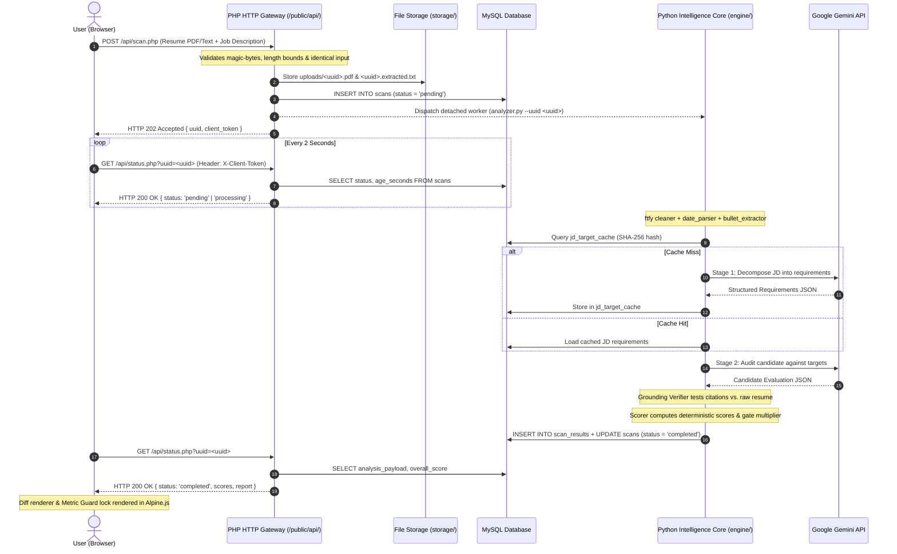

# Calibrate

**Automated Resume vs. Job Description Alignment & Optimization Workbench**  
*Dual-Engine Architecture: PHP 8.2+ Gateway & Python 3.10+ Intelligence Core*

---

## 1. Project Overview

**Calibrate** (repository: `ResumeJD-Matcher`) is an automated, local-first engineering workbench designed to evaluate how closely a candidate's resume aligns with a technical job description.

Rather than relying on naive keyword searches or unstructured, ungrounded Large Language Model (LLM) summaries, Calibrate breaks down the job description into discrete, categorized criteria (Core Must-Haves, Preferred Bonus Skills, and Experience Tenure). It then cross-references each requirement against the candidate's actual resume text, verifies evidence using deterministic string and fuzzy matching, calculates reproducible mathematical alignment scores, and provides structured bullet-point rewrite suggestions anchored directly to candidate achievements.

### Core Architectural Pillars

- **Deterministic Mathematical Scoring ($\sigma^2 = 0.00$):** Overall scores are computed through transparent mathematical formulas with non-linear gating thresholds. Given identical inputs, scoring produces zero variance across runs.
- **Verbatim Evidence Anchoring:** Requirements marked `MATCHED` are backed by verbatim sentence citations extracted from the resume. An automated Grounding Verifier cross-checks quotes and rejects negative or aspirational statements.
- **Asynchronous Decoupled Execution:** Upload validation and job tickets are processed through a fast PHP 8.2+ HTTP gateway, while compute-intensive text extraction, LLM interactions, and scoring run in a detached background Python worker.
- **Content-Addressable Requirement Caching:** Job descriptions are decomposed into requirements and cached in MySQL using SHA-256 content hashes, avoiding duplicate LLM calls when evaluating multiple candidates against the same job posting.
- **Metric Guard & Verification Gate:** AI-generated bullet rewrites that introduce quantified metrics (percentages, throughput, scale) lock the user interface clipboard copy button until the candidate inputs their actual verifiable numbers and checks a confirmation gate.
- **Document Root Isolation:** The web server DocumentRoot is strictly restricted to `public/`. Application source code, database credentials (`.env`), worker execution logs, and uploaded candidate documents (`storage/`) reside strictly outside the publicly accessible HTTP path.
- **Prompt Injection Defense:** Untrusted candidate resume text is isolated inside cryptographic nonces (`<CANDIDATE_RESUME_{nonce}>`) to prevent prompt hijacking from altering system instructions or schema contracts.

---

## 2. Key Capabilities

| Capability | Implementation Mechanism | Status |
|---|---|---|
| **Requirement Decomposition** | Decomposes job postings into Core Must-Haves, Preferred Bonus Skills, and Experience Tenure across six standard technical domains. | **Implemented & Verified** |
| **Verbatim Proof Verification** | Grounding verifier searches candidate text using RapidFuzz matching while enforcing negation guards (`never`, `no prior`, `lacks`) and aspirational guards (`eager to learn`, `planning to`). | **Implemented & Verified** |
| **Deterministic Scoring** | Transparent weighted scoring with essential-skill deal-breaker rules (score throttled if must-haves < 50%; zeroed if must-haves = 0%). | **Implemented & Verified** |
| **Experience Tenure Auditing** | Dynamic date range parser extracts candidate years and JD required tenure, masking company founding age to prevent false requirement extraction. | **Implemented & Verified** |
| **Bullet Re-Engineering** | Generates Google XYZ-style bullet upgrades (`Accomplished [X], as measured by [Y], by doing [Z]`) snapped to candidate original bullets. | **Implemented & Verified** |
| **Word-Level Visual Redlines** | Interactive redline comparison rendering deletions (strikethrough) and additions (highlighted tokens) with full XSS escaping. | **Implemented & Verified** |
| **Metric Guard Verification** | Dynamic lock card requiring candidate metric validation before unlocking clipboard copy operations for rewritten bullets. | **Implemented & Verified** |
| **Content-Addressable Cache** | SHA-256 target cache table (`jd_target_cache`) eliminating redundant LLM decomposition calls across multiple evaluations. | **Implemented & Verified** |
| **Identical Input Guard** | Normalizes whitespace, CRLF, and UTF-8 casing to reject identical resume and JD submissions with HTTP 422 before allocating storage or database records. | **Implemented & Verified** |
| **Asynchronous Watchdog** | Background watchdog timer automatically marks stalled or interrupted analysis tickets as `failed` after 90 seconds. | **Implemented & Verified** |

---

## 3. How the Application Works



### Processing Lifecycle

1. **Ingestion & Safety Guards:** The candidate resume (PDF, TXT, or pasted text) and job description (pasted text, TXT, or PDF) are received at [`/api/scan.php`](file:///C:/Users/vvina/Downloads/ResumeJD-Matcher/public/api/scan.php). The gateway enforces:
   - Magic-byte verification (`%PDF-` header check for uploaded PDF documents).
   - Character length bounds (80 to 25,000 characters for resumes; 80 to 15,000 characters for job descriptions).
   - Identical-input detection: rejects submissions where the candidate pasted the job description into both fields.
2. **Storage & Worker Dispatch:** A cryptographic UUID is generated. The resume is stored in `storage/uploads/<uuid>.pdf` (or `.txt`), pre-extracted text is written to a sidecar `<uuid>.extracted.txt`, and a record is created in the `scans` database table with status `pending`. The gateway launches a detached worker (`engine/analyzer.py --uuid <uuid>`) and returns `HTTP 202 Accepted` with a client authorization token.
3. **Deterministic Text Preparation:** The Python worker cleans raw text using `ftfy` (fixing broken encodings and mojibake) and decomposes Unicode NFKD ligatures (e.g., `fi` to `fi`). Experience dates and candidate bullet points are parsed deterministically before calling external services.
4. **Content-Addressable Requirement Caching:** The worker computes a SHA-256 hash of the normalized job description. If the requirements already exist in `jd_target_cache`, they are loaded instantly without making an LLM API call. If not cached, the worker requests structured requirement decomposition from Google Gemini and caches the result.
5. **Auditing & Grounding Verification:** The candidate's qualifications are evaluated against each requirement. The Grounding Verifier scans the raw resume text using RapidFuzz token matching to confirm that citations marked as evidence actually exist in the resume, downgrading unsupported or hallucinated claims.
6. **Deterministic Scoring:** The scorer calculates Must-Have coverage, Bonus Skill points, and Experience Tenure ratio. If Core Must-Have coverage falls below 50.0%, a non-linear gate multiplier throttles the overall score to prevent peripheral skills from inflating an unqualified profile.
7. **Client Polling & Metric Guard:** The browser polls [`/api/status.php`](file:///C:/Users/vvina/Downloads/ResumeJD-Matcher/public/api/status.php) every 2 seconds using the `X-Client-Token` header. Once completed, Alpine.js renders the Unified Requirements Ledger, word-level visual diffs, and the interactive Metric Guard card.

---

## 4. Technology Stack & Architecture

```text
ResumeJD-Matcher/
├── public/                             # Document Root (Exclusively exposed via HTTP)
│   ├── index.php                       # Single-page Alpine.js workbench interface
│   ├── api/
│   │   ├── scan.php                    # Ingestion, validation, & detached worker dispatch
│   │   ├── status.php                  # Polling endpoint, result delivery, & watchdog
│   │   ├── extract.php                 # Direct text extraction utility
│   │   └── validation_helpers.php      # Parameter normalization & identical-input validators
│   └── assets/                         # Public brand assets, CSS styles, & JS controllers
├── engine/                             # Python Intelligence Core (Strictly outside web root)
│   ├── analyzer.py                     # CLI worker entrypoint invoked by PHP gateway
│   ├── cleaner.py                      # Text encoding cleaner & Unicode NFKD normalizer
│   ├── gemini_client.py                # Gemini GenAI client with schema enforcement
│   ├── grounding_verifier.py           # Verbatim citation grounding & negation guards
│   ├── jd_target_cache.py              # SHA-256 target caching & model configuration
│   ├── pre_filter.py                   # RapidFuzz acronym resolver & taxonomy mapping
│   ├── scorer.py                       # Deterministic scoring with essential-skill gating
│   ├── parsers/                        # Layout-aware spatial PDF, date, & bullet parsers
│   └── requirements.txt                # Pinned Python package dependencies
├── config/                             # Database configuration (PDO MySQL)
├── database/                           # MySQL schema definition (DDL)
├── storage/                            # Working storage for uploads and logs (Outside web root)
├── cron/                               # Storage retention dry-run tools (Automated tasks disabled)
├── docs/                               # Architectural specifications & canonical brand assets
└── tests/                              # Automated test suites, fixtures, & benchmarks
```

### Component Breakdown

| Layer | Technologies | Responsibilities |
|---|---|---|
| **HTTP Gateway** | PHP 8.2+, PDO MySQL, Fileinfo | Handles HTTP requests, enforces upload file size limits, validates MIME types and magic bytes, creates scan records, dispatches background Python processes, and enforces rate limits. |
| **Intelligence Core** | Python 3.10+, `pdfplumber`, `ftfy`, `RapidFuzz`, `pydantic` | Extracts layout-aware text from PDF resumes, normalizes typography, parses experience tenure dates, queries target cache, interacts with Gemini API, validates citations, and computes deterministic scores. |
| **Relational Database** | MySQL 8.0+ / MariaDB 10.4+ | Stores scan tickets (`scans`), structured analysis results (`scan_results`), and content-addressable decomposed job requirements (`jd_target_cache`). |
| **Frontend UI** | Alpine.js 3.x, Tailwind CSS, jsdiff | Reactive single-page application handling asynchronous status polling, word-level visual diff rendering, state preservation, error translation, and the interactive Metric Guard verification workflow. |
| **External AI** | Google Gemini API (`google-genai` 2.31.0) | Decomposes job postings into structured requirements and audits candidate bullet points against requirements using Pydantic JSON schema enforcement. |

---

## 5. Prerequisites & Local Installation

### Prerequisites

Verify that your local system has the required runtimes installed:

- **PHP 8.2 or higher** with `pdo_mysql` and `fileinfo` extensions enabled in `php.ini`.
- **MySQL 8.0 or higher** (or MariaDB 10.4+).
- **Python 3.10 or higher** (tested up to Python 3.14 on Windows AMD64).
- **Node.js 18 or higher** (required for running browser logic unit tests).
- **Google Gemini API Key** (free tier supported; obtain from Google AI Studio).

---

### Step 1: Database Initialization

Create the database and import the table schema:

```powershell
# Log into MySQL and import the schema
mysql -u root -p < database\schema.sql
```

This creates the `jd_analyser` database with three InnoDB tables:
- `scans`: Tracks upload tickets, file paths, status (`pending`, `processing`, `completed`, `failed`), and client tokens.
- `scan_results`: Stores numeric scores and the full analysis JSON payload.
- `jd_target_cache`: Stores content-addressable job requirements indexed by SHA-256 hash.

---

### Step 2: Python Environment Setup

Create an isolated virtual environment and install the pinned dependencies:

```powershell
# Create virtual environment in engine/venv
python -m venv engine\venv

# Activate the virtual environment
.\engine\venv\Scripts\Activate.ps1

# Install pinned dependencies
pip install -r engine\requirements.txt
```

---

### Step 3: Environment Configuration

Copy the example environment template to create your local `.env` file:

```powershell
Copy-Item .env.example .env
```

Open `.env` in your text editor and configure your Gemini API key and local database credentials:

```ini
# Google Gemini API Credentials
GEMINI_API_KEY=your_actual_gemini_api_key_here
GEMINI_MODEL=gemini-3.5-flash

# Database Connection (MySQL / MariaDB)
DB_HOST=127.0.0.1
DB_PORT=3306
DB_NAME=jd_analyser
DB_USER=root
DB_PASS=

# Environment Mode
APP_ENV=development
APP_DEBUG=true
```

> [!WARNING]
> In `config/database.php`, database configuration keys are named `DB_NAME`, `DB_USER`, and `DB_PASS`. Do not rename them to `DB_DATABASE` or `DB_USERNAME`.

---

### Step 4: Run Pre-Flight Verification (Gate 0)

Verify that your Gemini API credentials and structured output schema work properly:

```powershell
.\engine\venv\Scripts\python.exe tests\test_gemini_free_tier.py
```

---

### Step 5: Launch the Development Server

#### Option A: 1-Click Automated Launcher (Recommended)

The provided PowerShell script automatically tests MySQL availability, clears any orphaned processes on port 8000, launches PHP with DocumentRoot set strictly to `public/`, and opens your default browser:

```powershell
.\run-dev.ps1
```

#### Option B: Manual PHP Server Launch

Ensure you pass `-t public` so the repository root is never served over HTTP:

```powershell
php -S 127.0.0.1:8000 -t public
```

Open your browser and navigate to `http://127.0.0.1:8000`.

---

## 6. Configuration & Environment Variables

All operational settings are managed through environment variables loaded from the root `.env` file:

| Variable Name | Default Value | Required | Purpose & Constraints |
|---|---|---|---|
| `APP_ENV` | `development` | Yes | Application environment (`development` or `production`). In development, rate limits are bypassed for localhost. |
| `APP_DEBUG` | `true` | No | Enables verbose exception traces and debugging messages. |
| `APP_URL` | `http://localhost:8000` | No | Canonical base URL used for asset routing and relative links. |
| `DB_HOST` | `127.0.0.1` | Yes | Hostname or IP address of the MySQL/MariaDB server. |
| `DB_PORT` | `3306` | Yes | Network port of the MySQL service. |
| `DB_NAME` | `jd_analyser` | Yes | Target database schema name (must match `schema.sql`). |
| `DB_USER` | `root` | Yes | Database username with `SELECT`, `INSERT`, `UPDATE`, `DELETE` privileges. |
| `DB_PASS` | *(empty)* | Yes | Database password corresponding to `DB_USER`. |
| `GEMINI_API_KEY` | *(none)* | **Yes (for AI)** | Google Gemini API key used for requirement extraction and bullet rewriting. |
| `GEMINI_MODEL` | `gemini-3.5-flash` | No | Primary Gemini model identifier used for analysis. Code fallback default: `gemini-3.5-flash-lite`. |
| `GEMINI_FALLBACK_MODELS` | `gemini-2.5-flash,gemini-1.5-flash` | No | Comma-separated list of fallback models tried sequentially if primary model hits rate limits. |
| `GEMINI_MAX_RETRIES` | `3` | No | Maximum retry attempts for transient external API errors (e.g., HTTP 429, 503). |
| `PYTHON_BIN` | `python` | No | Path to Python binary. Automatically resolves `engine/venv/Scripts/python.exe` on Windows if set to `python`. |
| `STORAGE_PATH` | `../storage/` | No | Filesystem location for temporary resume files and execution logs. |
| `MAX_DAILY_SCANS_PER_USER` | `20` | No | Maximum number of scans permitted per client token/subnet within a rolling 24-hour window. |
| `SYSTEM_DAILY_SCAN_CAP` | `1400` | No | Global community scan capacity ceiling across all users per rolling 24 hours. |
| `FORCE_RATE_LIMIT` | `false` | No | Set to `true` to force rate-limit enforcement even in local development or localhost testing. |
| `MAX_FILE_SIZE_BYTES` | `10485760` | No | Maximum allowed upload file size (default: 10 MB). |
| `MIN_INPUT_CHARS` | `80` | No | Minimum characters required for resume or job description input (default: 80). |
| `MAX_RESUME_CHARS` | `25000` | No | Maximum characters accepted for resume text before truncation. |
| `MAX_JD_CHARS` | `15000` | No | Maximum characters accepted for job description input. |
| `WATCHDOG_TIMEOUT_SECONDS` | `90` | No | Maximum execution window before a pending/processing ticket is marked `failed`. |
| `WEIGHT_MUST_HAVE` | `0.50` | No | Relative scoring weight for Core Must-Have criteria (50%). |
| `WEIGHT_EXPERIENCE` | `0.25` | No | Relative scoring weight for Experience Tenure criteria (25%). |
| `WEIGHT_BONUS` | `0.25` | No | Relative scoring weight for Preferred Bonus Skills criteria (25%). |
| `ESSENTIAL_SKILL_GATE_THRESHOLD`| `50.0` | No | Percentage of Must-Haves required before the gating penalty is lifted. |
| `MIN_GATE_MULTIPLIER` | `0.15` | No | Floor multiplier applied to the overall score when Must-Have score is between 0% and 50%. |

---

## 7. Mathematical Scoring Methodology

Calibrate does not ask the LLM to guess an arbitrary overall score. Instead, scoring is calculated purely in Python ([`engine/scorer.py`](file:///C:/Users/vvina/Downloads/ResumeJD-Matcher/engine/scorer.py)) from discrete, validated requirement outcomes.

### 1. Component Scores

- **Core Must-Haves Score ($S_{\text{must}}$):**
  $$\text{Matched Points} = \sum (\text{MATCHED} \times 1.0 + \text{WEAK} \times 0.5 + \text{MISSING} \times 0.0)$$
  $$S_{\text{must}} = \frac{\text{Matched Points}}{N_{\text{must}}} \times 100\% \quad (\text{defaults to } 100\% \text{ if } N_{\text{must}} = 0)$$

- **Preferred Bonus Skills Score ($S_{\text{bonus}}$):**
  $$S_{\text{bonus}} = \frac{\text{Bonus Points}}{N_{\text{bonus}}} \times 100\% \quad (\text{defaults to } 100\% \text{ if } N_{\text{bonus}} = 0)$$

- **Experience Tenure Score ($S_{\text{exp}}$):**
  $$S_{\text{exp}} = \min\left(100.0\%, \frac{\text{Candidate Years}}{\text{Required Years}} \times 100\%\right)$$

### 2. Tri-State Experience Integrity

If a job description does not specify required years (`NOT_SPECIFIED`), or if tenure was mentioned but could not be extracted reliably (`EXTRACTION_FAILED`), the experience component is excluded. The remaining weights are automatically renormalized across Must-Haves and Bonus skills to prevent awarding unearned 100% credit:

$$S_{\text{raw}} = \left(\frac{w_{\text{must}}}{w_{\text{must}} + w_{\text{bonus}}}\right) S_{\text{must}} + \left(\frac{w_{\text{bonus}}}{w_{\text{must}} + w_{\text{bonus}}}\right) S_{\text{bonus}}$$

### 3. Essential-Skill Non-Linear Gating Rule

Core Must-Haves represent non-negotiable prerequisites. If an applicant lacks essential criteria, strong secondary skills must not inflate their overall score:

- **Deal-Breaker Floor:** If $S_{\text{must}} = 0.0\%$, the overall score is forced to **$0.0\%$**.
- **Gated Throttling:** If $S_{\text{must}} < 50.0\%$, a gate multiplier is applied:
  $$\text{Multiplier} = \max\left(0.15, \frac{S_{\text{must}}}{50.0}\right)$$
  $$S_{\text{overall}} = S_{\text{raw}} \times \text{Multiplier}$$
- **Full Credit:** If $S_{\text{must}} \ge 50.0\%$, $\text{Multiplier} = 1.0$ and $S_{\text{overall}} = S_{\text{raw}}$.

> [!NOTE]
> **Score Interpretation:** Calibrate scores represent textual and evidence alignment against documented job criteria. A high score indicates strong alignment with the written description; it does not predict actual hiring decisions or evaluate qualities outside the text.

---

## 8. HTTP API Reference

All API routes are served under `/api/` with JSON responses and strict security headers (`X-Content-Type-Options: nosniff`, `X-Frame-Options: DENY`, `Cache-Control: no-store`).

### `POST /api/scan.php`

Submits a candidate resume and job description for asynchronous analysis.

**Request:** `multipart/form-data`
- `resume` *(file, optional)*: PDF or TXT resume document (max 10 MB).
- `resume_text` *(string, optional)*: Plain-text candidate resume (80 to 25,000 characters).
- `job_description` *(string, optional)*: Job description text (80 to 15,000 characters).
- `job_description_file` *(file, optional)*: PDF or TXT job posting document.
- `client_token` *(string, optional)*: 32-character hexadecimal client identifier.

**Response (`HTTP 202 Accepted`):**
```json
{
  "uuid": "4f9d8a3b2c1e4f0a9b8c7d6e5f4a3b2c",
  "client_token": "a1b2c3d4e5f60718293a4b5c6d7e8f90",
  "status": "pending",
  "message": "Resume accepted. Processing started in background."
}
```

**Common Error Codes:**
- `400 Bad Request`: Invalid file format, missing boundary, or corrupted PDF header.
- `413 Payload Too Large`: Uploaded file exceeds the configured 10 MB limit.
- `422 Unprocessable Content`: Inputs shorter than 80 characters, or identical resume and JD text submitted.
- `429 Too Many Requests`: Client token or subnet exceeded the 20-scan daily limit.

---

### `GET /api/status.php`

Polls the status and retrieves analysis results for an active scan ticket.

**Query Parameters:**
- `uuid` *(string, required)*: 32-character hexadecimal scan UUID.

**Headers:**
- `X-Client-Token` *(string, required)*: The 32-character token returned during ticket creation.

**Response (`HTTP 200 OK` - Completed):**
```json
{
  "uuid": "4f9d8a3b2c1e4f0a9b8c7d6e5f4a3b2c",
  "status": "completed",
  "error_message": null,
  "progress_message": "3/3 Analysis complete!",
  "scores": {
    "overall_score": 78.5,
    "raw_score": 78.5,
    "is_gated": false,
    "must_have_score": 85.0,
    "bonus_score": 65.0,
    "experience_score": 80.0
  },
  "report": {
    "must_haves": [
      {
        "criterion": "Production Python microservices and asyncio experience",
        "status": "MATCHED",
        "domain": "Languages & Frameworks",
        "candidate_evidence": "Engineered asynchronous Python microservices handling 12,000 requests per minute.",
        "is_verified": true
      }
    ],
    "bonus_skills": [],
    "actionable_rewrites": []
  }
}
```

---

### `POST /api/extract.php`

Utility endpoint to extract raw, normalized text from an uploaded PDF document without initiating a full analysis scan.

---

## 9. Testing & Verification Suites

Calibrate includes automated test suites covering unit logic, determinism, integration boundaries, and ground-truth benchmarks.

### 1-Click Master Test Runner

To execute all primary test layers sequentially and display a unified quality scorecard:

```powershell
.\run-tests.ps1
```

### Running Test Suites Individually

#### Offline Unit & Logic Tests (Run without MySQL or Gemini credentials)

```powershell
# Frontend State, Diff Renderer, & Metric Guard Logic (14 tests)
node tests\test_frontend_logic.js

# Experience Date Parser & Tenure Normalization (6 tests)
.\engine\venv\Scripts\python.exe tests\test_date_parser_regression.py

# Identical Input Detection & Normalization Boundary (13 tests)
php tests\test_identical_input_validation.php

# Citation Grounding & Negation Regression Suite
.\engine\venv\Scripts\python.exe tests\test_precision_audit_regression.py

# Candidate Evidence Completeness Verification
.\engine\venv\Scripts\python.exe tests\test_candidate_evidence_completeness.py

# PII Sanitization & Error Trace Redaction
.\engine\venv\Scripts\python.exe tests\test_privacy_pii_redaction.py

# Rewritten Bullet Metric Grounding Tests
.\engine\venv\Scripts\python.exe tests\test_rewrite_metric_grounding.py
```

#### Integration Tests (Requires local web server and MySQL database online)

```powershell
# HTTP Gateway Endpoint & Upload Boundary Verification
.\engine\venv\Scripts\python.exe tests\test_gateway_http.py

# CLI Worker Invocation & Determinism Tests
.\engine\venv\Scripts\python.exe tests\test_engine_cli.py

# Storage Retention Lifecycle Dry-Run (Simulation only)
php cron\cleanup.php --dry-run
```

#### Ground-Truth Benchmarks & AI Gate 0

```powershell
# Ground-Truth Accuracy Benchmark Harness
.\engine\venv\Scripts\python.exe tests\test_benchmark_accuracy.py

# Gate 0 Gemini API Connectivity & Schema Check (Consumes API quota)
.\engine\venv\Scripts\python.exe tests\test_gemini_free_tier.py
```

---

## 10. Troubleshooting & Common Diagnostics

### 1. Database Connection Failed (`SQLSTATE[HY000] [2002]`)
- **Cause:** Local MySQL service is stopped, running on an alternative port, or credentials in `.env` do not match.
- **Resolution:** Verify MySQL service status (`Get-Service MySQL` or start XAMPP). Check `.env` to ensure `DB_HOST=127.0.0.1`, `DB_PORT=3306`, and `DB_NAME=jd_analyser` match your MySQL setup.

### 2. Python Binary Not Found or Module Import Errors
- **Cause:** Python virtual environment has not been initialized in `engine/venv`.
- **Resolution:** Re-create the virtual environment and install dependencies:
  ```powershell
  python -m venv engine\venv
  .\engine\venv\Scripts\python.exe -m pip install -r engine\requirements.txt
  ```

### 3. Missing PHP Extensions (`pdo_mysql` or `fileinfo`)
- **Cause:** PHP CLI or web server running without required dynamic extensions enabled.
- **Resolution:** Open your `php.ini` file and uncomment:
  ```ini
  extension=pdo_mysql
  extension=fileinfo
  ```
  Restart your PHP development server.

### 4. PDF Text Extraction Failure ("Could not extract text from PDF")
- **Cause:** Uploaded PDF is a scanned image or photo without embedded selectable digital text.
- **Resolution:** Calibrate uses layout text extraction (`pdfplumber`). Provide an original digital PDF exported directly from Word, Google Docs, or LaTeX.

### 5. Port 8000 Already in Use
- **Cause:** A previous PHP server process did not terminate cleanly.
- **Resolution:** Use `.\run-dev.ps1`, which automatically clears orphaned processes on port 8000, or terminate manually:
  ```powershell
  Get-Process -Id (Get-NetTCPConnection -LocalPort 8000).OwningProcess | Stop-Process -Force
  ```

### 6. Scan Stuck in "Queued" or "Processing" State
- **Cause:** The background Python process failed before recording completion, or Gemini API hit rate limits.
- **Resolution:** Check the execution log file in `storage/logs/<uuid>.log` for the exact Python stack trace. Stalled tickets are automatically marked as `failed` after 90 seconds by the gateway watchdog.

---

## 11. Security, Privacy, and Operational Boundaries

- **Document Root Enforcement:** When deploying to Apache, Nginx, or IIS, set the web server **DocumentRoot** strictly to the `public/` directory. Never serve the repository root over HTTP.
- **External Data Transmission:** Candidate resume text and job description content are transmitted over HTTPS to the Google Gemini API for requirement decomposition and evaluation. Organizations with strict on-premises data residency policies should note this external transmission.
- **Local PII Redaction:** The Python worker sanitizes phone numbers and email addresses (`sanitize_pii()`) from error messages and logs before writing failure states to the database.
- **Storage Isolation:** Uploaded resumes and worker execution logs are stored strictly in `storage/` outside the web root. On POSIX environments, uploaded files receive `0600` permissions.
- **Operational Policy — Retention Scheduled Task Disabled:** Automatic scheduled file deletion via Windows Task Scheduler (`cron\setup-cleanup-task.ps1`) is **disabled by policy**. Simulation dry-runs are supported via `php cron\cleanup.php --dry-run`. Do not register live automated purge tasks without explicit retention approval.

---

## 12. License & Development Status

This repository is currently maintained as an **independent, private engineering project**. No open-source license is granted; all rights are reserved by the repository owner.

- **Changes & Contributions:** Internal modifications must maintain strict architectural separation between the PHP gateway and Python core, preserve deterministic scoring integrity, and pass all baseline regression test suites before submission.
